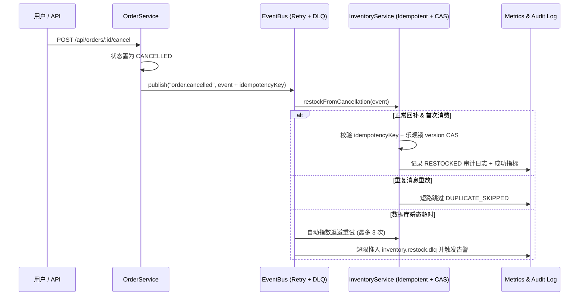

# 零售订单与库存服务架构说明（Architecture Overview）

## 1. 现状痛点（改造前基线）
在大促高峰期，大量用户下单锁库后在 5 分钟内取消订单。当前系统存在以下断层：
- `OrderService.cancelOrder()` 仅将订单状态更新为 `CANCELLED`，未向 `EventBus` 发送实时库存释放事件，依赖每小时跑批任务（Hourly Batch Job）回补库存。
- `EventBus.publish()` 缺少指数退避重试与死信队列（`inventory.restock.dlq`）兜底。
- `InventoryService.restockFromCancellation()` 缺少基于 `idempotencyKey` 的幂等去重与基于 `version` 的乐观锁（CAS）并发保护。

## 2. 目标架构（Agentic SDLC 改造后）

